<p align="center">
  <picture>
    <source media="(prefers-color-scheme: dark)" srcset="docs/assets/banner-dark.svg">
    
  </picture>
</p>

<p align="center">
  <a href="https://github.com/farhanakhtar0x66/proofbench/actions/workflows/ci.yml"></a>
  
  
  
  
</p>

**Geek Room Global AI Hackathon 2026 · Bifrost priority track: PS01 (token-efficient coding agent) + PS04 (a gateway feature operators would miss) · with the Tavily PS06 verifier.**

# ProofBench Cascade

**Change one URL, and your coding agent starts on a small model and calls the big one only when its own tests prove it is stuck.**

Cascade is an OpenAI-compatible router in front of a [Bifrost](https://github.com/maximhq/bifrost) gateway. It reads the test output your agent already sends back, so it needs no plugin or SDK. While the checks pass, every call goes to the cheap tier. When the same failure repeats, ProofBench's loop breaker escalates to the large tier and replaces the failed history with a compact **autopsy** of the errors and diffs. Once the fix is verified, it drops back to the cheap tier.

<p align="center">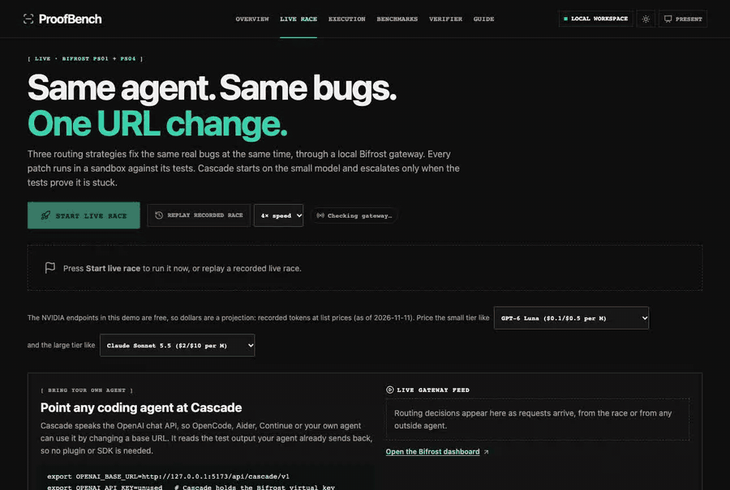</p>

## ⚡ Results

### The live race: same bugs, three routing strategies, at the same time

Five real JavaScript bugs, one agent loop, three lanes, all through a local Bifrost gateway (virtual key, $5/day budget, NVIDIA NIM models). Every patch runs in a sandbox against its `node:test` suite.

**Across every recorded live race (3 runs, 2026-11-19, [evidence](docs/evidence/cascade/)):**

| Lane | Fixed | Projected cost* | Total time |
|:--|:-:|--:|--:|
| Small model only (Laguna XS 2.1) | 13/15 | $0.010 | 132 s |
| Big model only (Nemotron 3 Ultra 550B) | 15/15 | $0.33 | 524 s |
| **Cascade** | **15/15** | **$0.13** | **257 s** |

**Cascade fixed everything the big model did, for 60% less and in about half the time.** It was cheaper in 2 of the 3 races (98% and 82% less). In the third it cost 26% more, because its first escalated call ran to the 6,000-token output cap without returning code, while the big-only lane fixed the same bug on its first try. The page shows all three runs, including that loss.

**The race in the GIF (one of the three):**

| Lane | Fixed | Calls | Tokens | Projected cost* | Time |
|:--|:-:|--:|--:|--:|--:|
| Small model only (Laguna XS 2.1) | **4/5**, stuck on `calc` | 9 | 21,671 | $0.004 | 50 s |
| Big model only (Nemotron 3 Ultra 550B) | 5/5 | 8 | 27,967 | $0.21 | 332 s |
| **Cascade** | **5/5** | **7** | **13,930** | **$0.039** | **85 s** |

In this run Cascade fixed everything for 82% less than the big model alone and finished 3.9× sooner. On `calc`, the big model fixed the bug on its first escalated try with the autopsy; on its own it needed four attempts, two of which ran out of tokens.

<table>
  <tr>
    <td width="60%"><picture><source media="(prefers-color-scheme: dark)" srcset="docs/assets/screens/race-lanes-dark.jpg">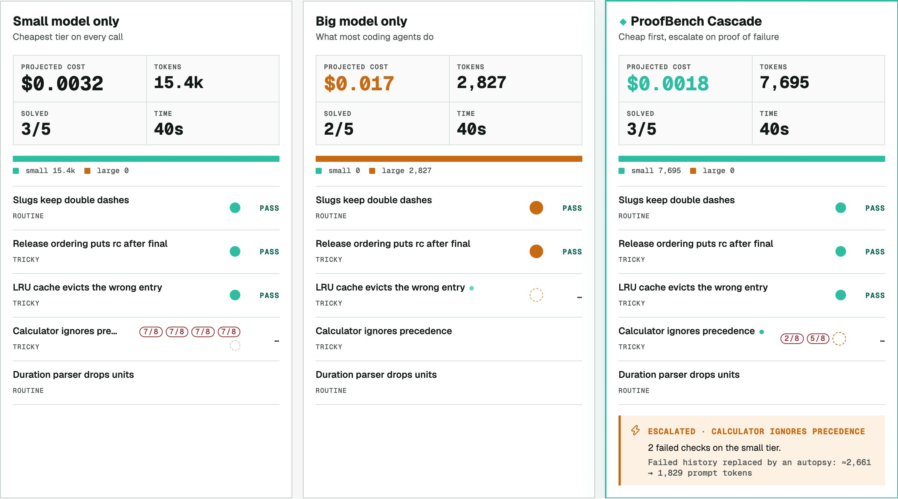</picture></td>
    <td width="40%"><picture><source media="(prefers-color-scheme: dark)" srcset="docs/assets/screens/race-result-dark.jpg">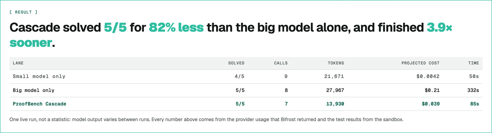</picture></td>
  </tr>
</table>

### A real, unmodified agent: OpenCode through Cascade

We ran the **real OpenCode CLI (v2.2.5)** with only its base URL changed, against the same tasks, and graded each result in the sandbox. The baseline is the same path pinned to the big model (`model: "cascade:large"`), so the only difference is routing ([evidence](docs/evidence/cascade/opencode/)):

| Task | Route | Runs | Passed | Median projected cost* | Median time | Escalations |
|:--|:--|:-:|:-:|--:|--:|:-:|
| `slugify` (routine) | **Cascade** · Big only | 1 · 1 | 1/1 · 1/1 | **$0.002** · $0.052 | **5 s** · 20 s | 0 |
| `duration` (routine) | **Cascade** · Big only | 1 · 1 | 1/1 · 1/1 | **$0.003** · $0.049 | **11 s** · 20 s | 0 |
| `lru` (tricky) | **Cascade** · Big only | 1 · 1 | 1/1 · 1/1 | **$0.002** · $0.067 | **9 s** · 22 s | 0 |
| `semver` (tricky) | **Cascade** · Big only | 1 · 1 | 1/1 · 1/1 | **$0.003** · $0.072 | **16 s** · 29 s | 0 |
| `calc` (small model gets stuck) | **Cascade** · Big only | 2 · 2 | 2/2 · 2/2 | **$0.126** · $0.273 | **68 s** · 89 s | 1 per run |

**Across all 12 runs, both routes fixed every task. Cascade's total was $0.26 against $0.79 for the big model alone (67% less), with Cascade faster on every task.** On routine bugs the small model finishes the job, so Cascade costs about 95% less. On `calc` Cascade escalated once per run.

We changed one thing after measuring. In the first two `calc` runs, Cascade did not touch OpenCode's tool-call transcript, so after escalating, the big model re-read every failed small-model step and Cascade cost *more* ($0.23 and $0.14, against $0.10 and $0.17 for big-only). We then added safe compaction: every tool call and its result are kept in order, and only the bulky text of superseded outputs is elided. The table shows only runs on the final code, from 17:50 UTC on 2026-11-19. The earlier runs are described here rather than hidden.

> [!NOTE]
> **What we don't claim.** These are single runs and small samples, not statistics: model output and NVIDIA's free-tier latency vary from run to run, and big-only varied 3× between identical runs. Dollars are projections: the demo's NVIDIA endpoints are free, so recorded tokens are priced at list rates (\*small tier as GPT-6 Luna, large tier as Claude Sonnet 5.5, as of 2026-11-11; switchable on the page). On a task that *needs* the big model, Cascade can only save what the autopsy and compaction remove; the large win comes from the many tasks the small model fixes alone.

## 🔁 How Cascade routes

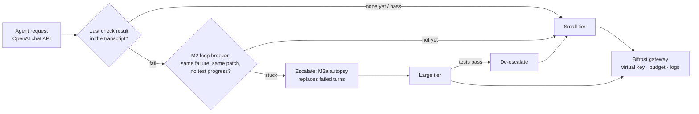

- **Outcome-based, not a guess.** Bifrost 2.6 ships a complexity analyzer that predicts difficulty from the prompt. Cascade routes on what the tests actually report: TAP, pytest and cargo-style output in the agent's own tool results.
- **Compression that never breaks a transcript.** Plain chats: failed turns are replaced by the autopsy. Tool-call transcripts: no message is dropped or reordered (that would orphan a tool result); the bulky text of superseded tool outputs is elided instead. Either way, the compacted prompt is used only when it is actually smaller.
- **Governed by Bifrost.** Every call carries Cascade's virtual key: only the two tier models are allowed, with a daily budget, and every request shows up in Bifrost's logs and dashboard.
- **Pin a tier when you need to.** `cascade:small` and `cascade:large` force a tier on the same path, which is how the baselines above were run.

## 🔌 Use it from any agent

```bash
export OPENAI_BASE_URL=http://127.0.0.1:3001/api/cascade/v1
export OPENAI_API_KEY=unused   # Cascade holds the Bifrost virtual key
# then use the model "cascade" (or cascade:small / cascade:large)
```

Responses carry `x-cascade-session`, `x-cascade-tier` and `x-cascade-model` headers and a `cascade` block explaining each decision. Streaming is supported. The **Live race** page shows a live gateway feed of every decision, from the race or from any outside agent.

## 🚀 Quick start

**Replay a recorded live race: no keys, no gateway.**

```bash
git clone https://github.com/farhanakhtar0x66/proofbench.git && cd proofbench
npm ci
npm run dev        # API on :3001, web on http://localhost:5173
```

Open **http://localhost:5173/race** and press **Replay recorded race**, or press **P** for the five-minute presentation.

**Run it live** (Node 22.12+; a free NVIDIA NIM key from build.nvidia.com):

```bash
# 1. Start Bifrost with a setup token of your choice
BIFROST_SETUP_TOKEN=change-me npx -y @maximhq/bifrost -app-dir .local/bifrost -port 8089
# 2. In .env: NVIDIA_API_KEY=... and BIFROST_SETUP_TOKEN=change-me, then:
npm run cascade:setup   # registers NVIDIA in Bifrost, creates the governed virtual key, writes it to .env
npm run dev             # then press "Start live race" on /race
```

From the terminal: `npm run cascade:race` runs a live race and saves it; `npm run cascade:opencode -- calc` runs real OpenCode through Cascade (`--direct-large` for the baseline); `npm run cascade:summary` prints the OpenCode table above.

## 🛡️ The sandbox

Model-written code runs under Node's permission model: it may read only its own task folder and has no network, child processes, workers or file writes. A runaway loop is killed after 15 s. Tests cover each of these (`tests/cascade.test.ts`). For OpenCode runs, its bash tool is limited to running the task's test file, with an isolated HOME.

---

# The engine underneath: ProofBench

Cascade is built on ProofBench's governed coding agent: the M2 loop breaker, the M3a failure autopsy and the evidence-first reporting described below were all measured before Cascade existed.

## ⚡ ProofBench results (before Cascade)

Four numbers, each from a saved live run you can open in the app and download as JSON.

| | | |
|:--|:--|:--|
| **~20×** | fewer tokens per repair trial | 860 vs 17,438 median tokens against OpenCode, on the same C++ bugs, model and gateway. **Both passed 6 of 6.** |
| **42.6%** | fewer tokens than the big model alone | Start on Qwen 1.5B, escalate to 9B only after a diagnosed failure: 4,461 vs 7,766 tokens, and 2.6× faster. |
| **12 / 12** | patches pass hidden tests | Built in a Docker sandbox with no network, graded against a pinned reference oracle. |
| **2+** | independent sources before any verdict | The verifier fails closed: a timeout, a malformed answer or an undated page never counts as evidence. |

<p align="center">
  <picture>
    <source media="(prefers-color-scheme: dark)" srcset="docs/assets/chart-tokens-dark.svg">
    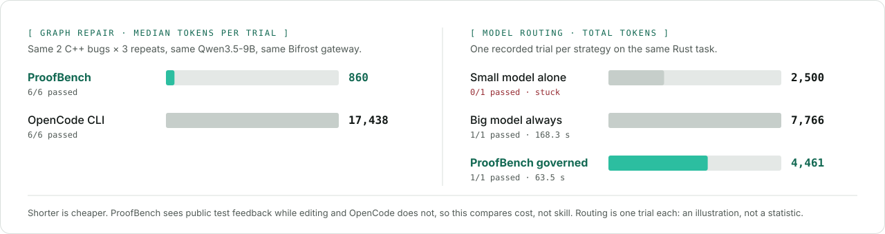
  </picture>
</p>

> [!NOTE]
> **What we don't claim.** ProofBench does not beat OpenCode on correctness: pass rates were equal, and ProofBench sees public test feedback while editing where OpenCode doesn't, so this compares *cost*, not skill. The routing result is one trial per strategy, an illustration rather than a statistic. A verifier verdict is a model-assisted evidence assessment, not proof. Our first Graph Repair pilot reported OpenCode at 0 of 6; it didn't reproduce, so we published the rerun instead.

## 🔍 See it

<table>
  <tr>
    <td width="50%" valign="top">
      <b>Graph Repair scorecard</b><br><sub>Two agents, the same bugs, test seeds and model. Every verdict opens its checks, patch and trace.</sub><br><br>
      <picture>
        <source media="(prefers-color-scheme: dark)" srcset="docs/assets/screens/scorecard-dark.jpg">
        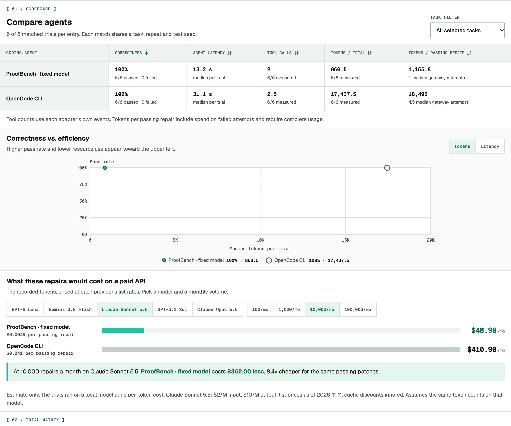
      </picture>
    </td>
    <td width="50%" valign="top">
      <b>What it would cost on a paid API</b><br><sub>The recorded input and output tokens priced at list rates. At Claude Sonnet 5.5 and 10,000 repairs a month: about $49 vs $411.</sub><br><br>
      <picture>
        <source media="(prefers-color-scheme: dark)" srcset="docs/assets/screens/cost-dark.jpg">
        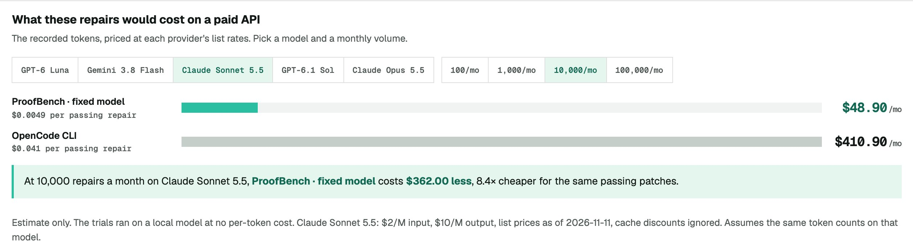
      </picture>
    </td>
  </tr>
  <tr>
    <td colspan="2" valign="top">
      <b>The escalation ladder</b><br><sub>The small model alone gets stuck. The big model passes at full price. ProofBench tries small, stops repeat failures, and sends the 9B an autopsy of only the errors and diffs.</sub><br><br>
      <picture>
        <source media="(prefers-color-scheme: dark)" srcset="docs/assets/screens/ladder-dark.jpg">
        
      </picture>
    </td>
  </tr>
  <tr>
    <td width="50%" valign="top">
      <b>Freshness verifier</b><br><sub>"Steve Ballmer is the current CEO of Microsoft": contradicted by two independent sources. A third agreed, but its page date was invalid, so it wasn't counted.</sub><br><br>
      <picture>
        <source media="(prefers-color-scheme: dark)" srcset="docs/assets/screens/verifier-dark.jpg">
        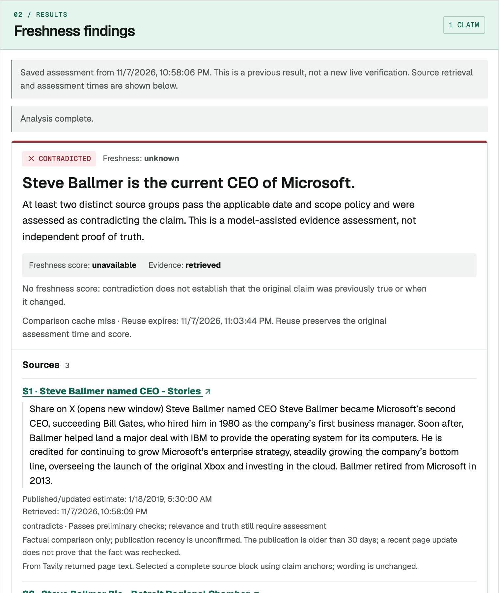
      </picture>
    </td>
    <td width="50%" valign="top">
      <b>Execution map</b><br><sub>Task, routing, execution, checks and verdict for any recorded run, with the trace and acceptance evidence beside it.</sub><br><br>
      <picture>
        <source media="(prefers-color-scheme: dark)" srcset="docs/assets/screens/execution-dark.jpg">
        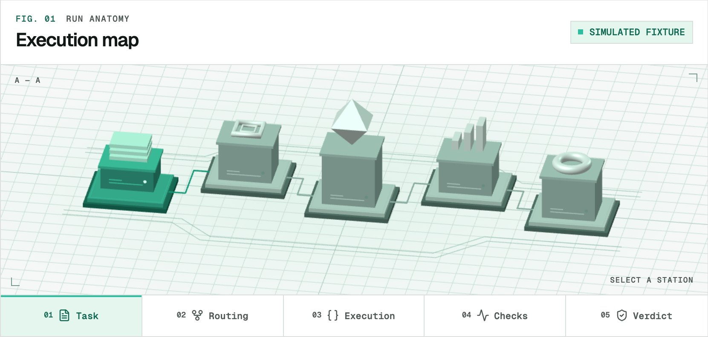
      </picture>
    </td>
  </tr>
</table>

## 🚀 Quick start (ProofBench workspace)

The demo needs **no model, no API key and no Docker**: every screen is backed by saved live records.

```bash
git clone https://github.com/farhanakhtar0x66/proofbench.git && cd proofbench
npm ci

# Load the saved live session and the saved verifier assessment
mkdir -p .local/data
cp docs/evidence/local-rerun-2026-11-07/graph-repair-94313e39-41f0-497e-b215-f2f43a7196a3.json .local/data/track-d-94313e39-41f0-497e-b215-f2f43a7196a3.json
cp docs/evidence/local-rerun-2026-11-07/tavily-live-8.json .local/data/analysis-994ce642-e336-4273-9ce3-37e8d01c2a52.json

BIFROST_IMPLEMENTATION=mock npm run dev   # API on :3001, web on http://localhost:5173
```

Then open **http://localhost:5173** and press **P**.

Requires **Node.js 22.12+**. Rust/Cargo is only needed for the native acceptance suites.

## 🎤 Present it

ProofBench has a built-in presentation mode. Press **P** (or the **Present** button, or open `/?present`). It starts on a title card and walks a five-minute pitch in eight stops. Each stop opens the right page, scrolls to the right part and runs the demo itself: it starts the live race (or replays a recorded live race when no gateway is running), replays the routing ladder and loads the saved verifier assessment, so nothing is typed on stage.

<table>
  <tr>
    <td width="50%">
      <picture>
        <source media="(prefers-color-scheme: dark)" srcset="docs/assets/screens/present-title-dark.jpg">
        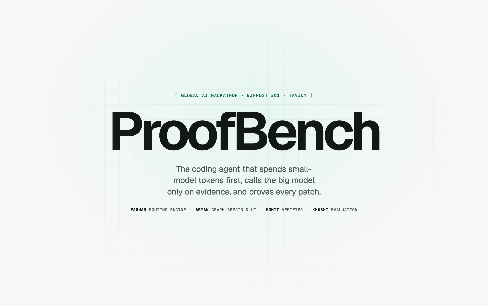
      </picture>
    </td>
    <td width="50%">
      <picture>
        <source media="(prefers-color-scheme: dark)" srcset="docs/assets/screens/present-close-dark.jpg">
        
      </picture>
    </td>
  </tr>
</table>

| Key | Does |
|:--|:--|
| <kbd>→</kbd> <kbd>Space</kbd> <kbd>PageDown</kbd> | Next stop (works with a presentation clicker) |
| <kbd>←</kbd> <kbd>PageUp</kbd> | Previous stop |
| <kbd>N</kbd> | Speaker cues on the stage screen |
| <kbd>S</kbd> | Speaker window for your laptop: cues, next stop, a 5:00 pace clock. It drives the stage. |
| <kbd>D</kbd> | Light or dark theme (works everywhere) |
| <kbd>R</kbd> · <kbd>Home</kbd> · <kbd>End</kbd> · <kbd>Esc</kbd> | Restart the clock · first stop · last stop · exit |

The talking points and timings are in [`docs/DEMO-WALKTHROUGH.md`](docs/DEMO-WALKTHROUGH.md).

## 🧠 How it works

ProofBench separates two kinds of failure that most agents blur together: **the provider going down** (handled by the gateway, same model) and **the model being stuck** (handled by escalation, bigger model).

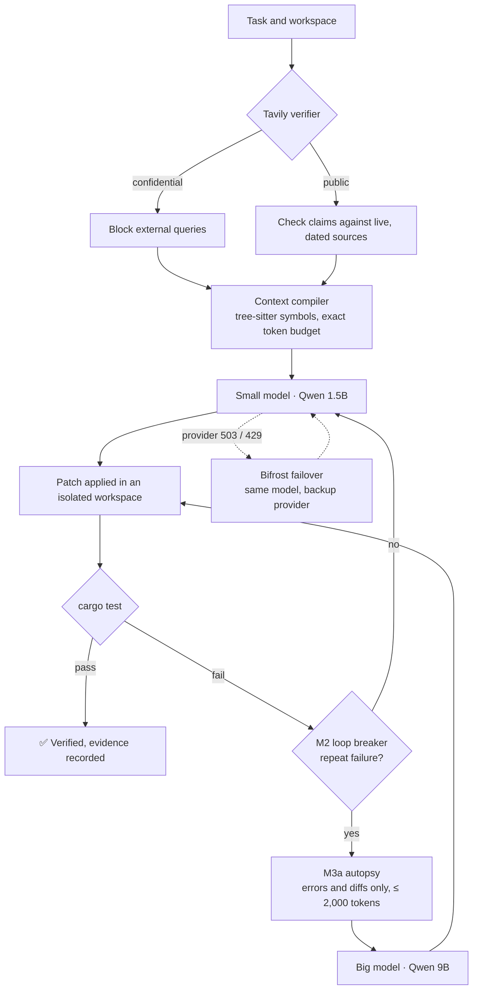

<details>
<summary><b>The three layers</b></summary>
<br>

**1. Maxim AI Bifrost gateway (transport).** Hierarchical virtual-key budgets, fail-closed confidential routing (loopback only when `confidential = true`), and multi-provider failover. On an injected HTTP 503 or 429 the same turn is retried on a backup provider with the model unchanged, and the trace records it.

**2. Governed execution loop (cognition).** A clean-room TypeScript controller:
- **M1, context bounding.** Tree-sitter finds the symbols the task needs; exact BPE token counts; an omission ledger records what was left out and why.
- **M2, loop breaker.** Detects stagnation and oscillation on repeated failure signatures and halts the small model.
- **M3a, failure autopsy.** Builds an evidence-only packet (compiler diagnostics and failed diffs), compacts it to budget and hands it to the recovery model.

**3. Tavily freshness verifier (facts).** Extracts claims, retrieves live sources, has a local model compare each excerpt, and lets the backend decide. One source is never enough, and stale pages can't confirm a "current" claim.

</details>

<details>
<summary><b>Adaptive Execution Engine: non-LLM first</b></summary>
<br>

A deterministic host controller is the only thing that decides tier transitions. It starts with no model at all and climbs only when the evidence says it must.

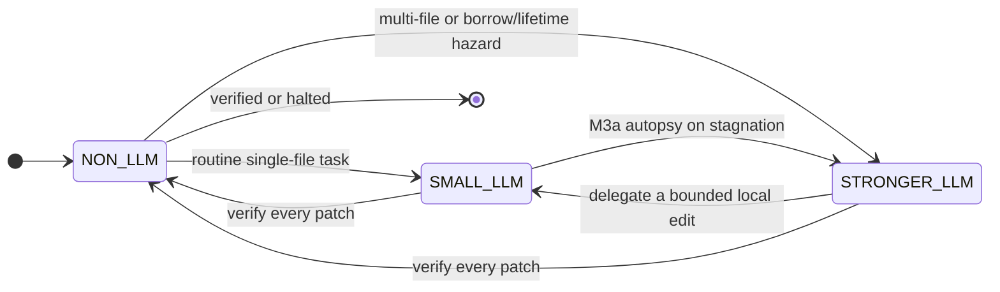

- **Zero tokens when possible.** If repository analysis or a compiler-guided mechanical fix resolves the issue, no model is called.
- **Project memory in `CONTEXT.MD`.** Eleven readable sections (identity, requirements, decisions, verified progress, known failures, next action…). It records state but never overrides host policy.
- **Durable state in `.proofbench/`.** `state.json`, an append-only `events.jsonl`, atomic checkpoints, patches and evidence. A killed process resumes from its checkpoint.
- **Oscillation detection.** Ping-pong between tiers on the same failure halts the run instead of burning budget.

Six acceptance scenarios (A–F) cover every transition, including restart recovery: `npx vitest run tests/adaptive-engine.test.ts`.

</details>

<details>
<summary><b>Repository map</b></summary>
<br>

```text
apps/
  api/            Fastify API: runs, jobs, benchmarks, verifier, Graph Repair sessions
  web/            React + Vite workspace (overview, execution, benchmarks, verifier, presentation mode)
packages/
  contracts/      Versioned Zod schemas shared by every boundary
  agent-adapters/ Adapter interface between the API and an implementation
  report-engine/  Turns execution records into evidence reports
  tavily/         Freshness verifier: claim extraction, retrieval, assessment
implementations/
  bifrost-01/     Governed coding agent, embedded gateway, adaptive engine
  bifrost-02/     Graph Repair (Track D) harness, grader and adapters
fixtures/         Frozen coding tasks, freshness cases, Graph Repair oracle
scripts/          Benchmarks, demonstrations and evidence checks
docs/             Architecture, contracts, evidence, walkthrough, handoffs
```

</details>

## 🧪 Reproduce everything

Every result can be rerun with one command. Offline commands need no paid API access.

| Command | What it verifies | Evidence written to |
|:--|:--|:--|
| `npm run cascade:race` | **Live:** three-lane race through Bifrost and the sandbox | `.local/data/cascade-races/<id>.json` |
| `npm run cascade:opencode -- calc [--direct-large]` | **Live:** real OpenCode through Cascade, or pinned to the big model | `.local/data/cascade-opencode/*.json` |
| `npm run cascade:summary` | The OpenCode table in this README, from the saved runs | console |
| `npx vitest run tests/cascade.test.ts` | Routing, autopsy, compaction, streaming, sandbox, race (offline) | console |
| `npm run check` | ESLint, TypeScript, 996 unit tests, fixture regressions, build | console |
| `npm run test:ui` | 40 Playwright browser tests, desktop and mobile | `test-results/` |
| `npm run test:contracts` | Zod v1 contracts across traces, runs and reports | console |
| `npm run test:failover` | Bifrost failover policy with in-process fault injection | `.local/data/bifrost-failover-evidence.json` |
| `npm run test:real-failover` | The stock Bifrost daemon under injected 503 / 429 outages | `.local/data/real-bifrost-failover-evidence.json` |
| `npm run test:freshness` | Task 4 under `#![deny(deprecated)]`: fails without Tavily, passes with it | `.local/data/tavily-freshness-evidence.json` |
| `npm run benchmark:strategies` | Direct small vs direct frontier vs governed escalation | `.local/data/strategy-benchmark-evidence.json` |
| `npm run benchmark:optimization` | Six configurations and component ablations across five tasks | `.local/data/optimization-benchmark-evidence.json` |
| `npm run benchmark:graph:matrix` | **Live:** Graph Repair, 2 agents × 2 tasks × 3 repeats, through the running API and Docker sandbox | `.local/data/track-d-<session>.json` |

Live runs need the local model, Bifrost, a Tavily key and a `.env`: see [`docs/LOCAL-LIVE-RERUN-2026-11-07.md`](docs/LOCAL-LIVE-RERUN-2026-11-07.md) and [`docs/REPRODUCTION_GUIDE.md`](docs/REPRODUCTION_GUIDE.md).

## 🛡️ ProofBench guardrails

- **Default-deny writes.** Workspace mutations need explicit, task-scoped host grants. Model self-approvals and writes outside the workspace are rejected.
- **Confidential mode stays local.** Bifrost routes only to verified loopback endpoints, and Tavily queries are blocked so source code and intent never leave the machine.
- **No invented numbers.** Missing provider usage is recorded as missing, never as zero, and efficiency figures use only trials where both sides reported verified usage.
- **Retrieved pages are data, not instructions.** Page text can't change tool policy, and similarity is never treated as verification.

Known limits: workspaces are isolated temporary directories, not kernel-level sandboxes (use containers for untrusted multi-tenant code), and the M3a autopsy budget uses a character-ratio estimate rather than a native tokenizer. Full notes in [`SECURITY.md`](SECURITY.md) and [`docs/ARCHITECTURE.md`](docs/ARCHITECTURE.md).

## 👥 Team

| | Member | Built |
|:--|:--|:--|
|  | **Aryan Vishwakarma** ([@Aryanxp1](https://github.com/Aryanxp1)) · team lead | Product direction, the web workspace, the Graph Repair benchmark |
|  | **Farhan Akhtar** ([@farhanakhtar0x66](https://github.com/farhanakhtar0x66)) | Cascade, governed agent, routing engine, Bifrost integration, benchmarks |
| | **Mohit** | Tavily verifier, claim extraction and freshness contracts |
| | **Khushi Yadav** | Evaluation criteria, acceptance validation, independent reproduction |

## 🙏 Credits

- **Graph Repair reference oracle:** [Speed Demon 2026](https://github.com/hackathon-raptors/speed-demon-2026) Track D by Hackathon Raptors CIC (MIT), byte-identical and SHA-256 pinned.
- **API price table** behind the cost projection: adapted from NeuroMesh. The dark theme's palette also comes from NeuroMesh.
- **Gateway:** [Bifrost](https://github.com/maximhq/bifrost) by Maxim AI, run unmodified (v2.6.0). **Models:** NVIDIA NIM (Laguna XS 2.1, Nemotron 3 Ultra 550B). **Agent under test:** [OpenCode](https://github.com/sst/opencode) v2.2.5, unmodified.
- Everything reused is listed with its revision and license in [`docs/REUSE-DISCLOSURE.md`](docs/REUSE-DISCLOSURE.md).

## 🤖 AI used in this project

- **In the product:** small and large LLMs (Laguna XS 2.1, Nemotron 3 Ultra 550B via NVIDIA NIM) behind a Bifrost gateway write the patches; Cascade decides which one answers; the Tavily verifier uses a local model to compare claims with live sources.
- **In development:** the team used AI coding assistants (including Claude Code) for implementation, tests and documentation. Every number in this README comes from a saved run in `docs/evidence/`.

<p align="center"><sub>Built for the Global AI Hackathon 2026 · Bifrost PS01 + PS04 · Tavily · <b>Small model first. Big model on proof.</b></sub></p>
