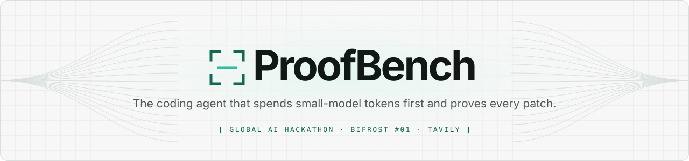
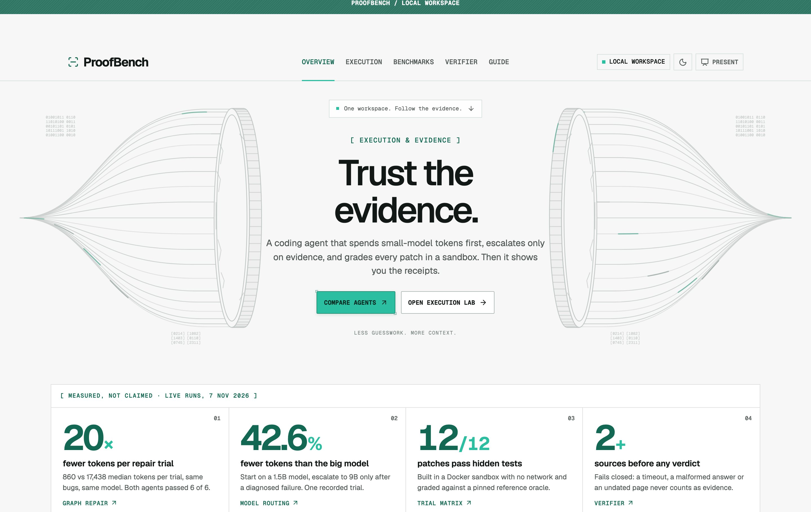
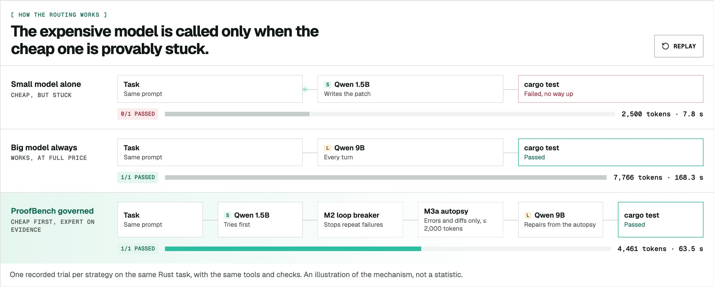
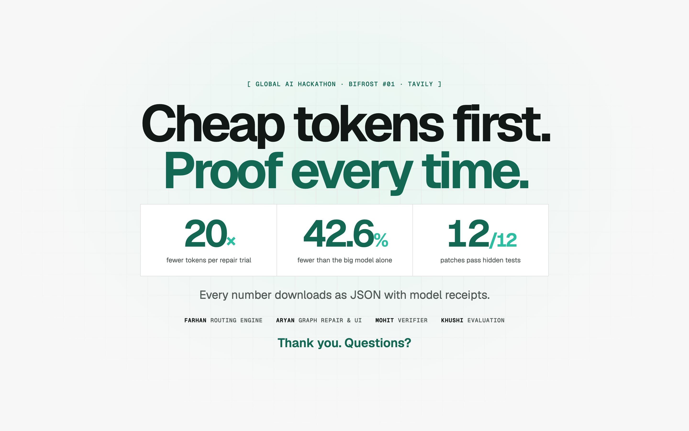
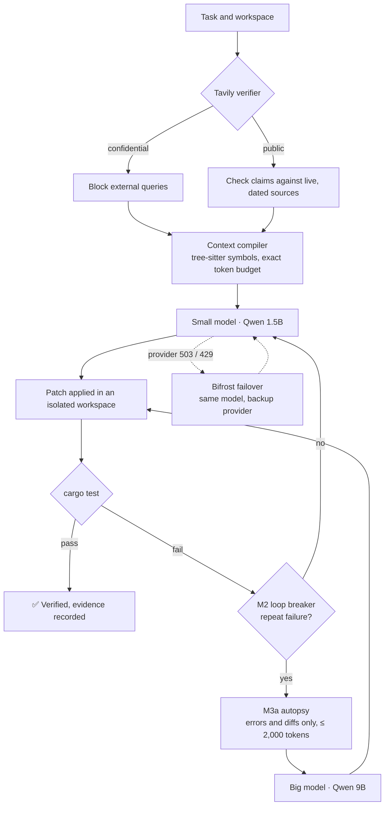
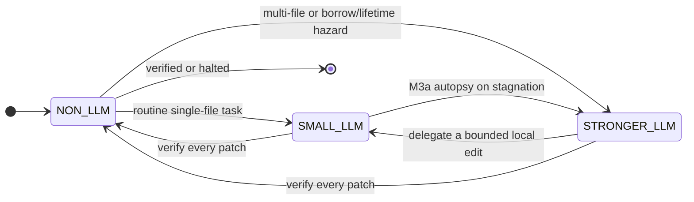

<p align="center">
  <picture>
    <source media="(prefers-color-scheme: dark)" srcset="docs/assets/banner-dark.svg">
    
  </picture>
</p>

<p align="center">
  <a href="https://github.com/farhanakhtar0x66/proofbench/actions/workflows/ci.yml"></a>
  
  
  
  
  
</p>

<p align="center">
  <a href="#-the-results">Results</a> ·
  <a href="#-see-it">See it</a> ·
  <a href="#-quick-start">Quick start</a> ·
  <a href="#-present-it">Present it</a> ·
  <a href="#-how-it-works">How it works</a> ·
  <a href="#-reproduce-everything">Reproduce</a> ·
  <a href="#-team">Team</a>
</p>

---

Coding agents burn expensive tokens on every step and then ask you to trust the result. **ProofBench does the opposite.** It starts on a small model, calls the big one only when a failure is diagnosed, grades every patch in a sandbox, and checks factual claims against sources you can open. Then it shows you the receipts.

<p align="center">
  <picture>
    <source media="(prefers-color-scheme: dark)" srcset="docs/assets/screens/hero-dark.jpg">
    
  </picture>
</p>

## ⚡ The results

Four numbers, each from a saved live run you can open in the app and download as JSON.

| | | |
|:--|:--|:--|
| **~20×** | fewer tokens per repair trial | 860 vs 17,438 median tokens against OpenCode, on the same C++ bugs, model and gateway. **Both passed 6 of 6.** |
| **42.6%** | fewer tokens than the big model alone | Start on Qwen 1.5B, escalate to 9B only after a diagnosed failure: 4,461 vs 7,766 tokens, and 2.6× faster. |
| **12 / 12** | patches pass hidden tests | Built in a Docker sandbox with no network, graded against a pinned reference oracle. |
| **2+** | independent sources before any verdict | The verifier fails closed: a timeout, a malformed answer or an undated page never counts as evidence. |

<p align="center">
  <picture>
    <source media="(prefers-color-scheme: dark)" srcset="docs/assets/chart-tokens-dark.svg">
    
  </picture>
</p>

> [!NOTE]
> **What we don't claim.** ProofBench does not beat OpenCode on correctness: pass rates were equal, and ProofBench sees public test feedback while editing where OpenCode doesn't, so this compares *cost*, not skill. The routing result is one trial per strategy, an illustration rather than a statistic. A verifier verdict is a model-assisted evidence assessment, not proof. Our first Graph Repair pilot reported OpenCode at 0 of 6; it didn't reproduce, so we published the rerun instead.

## 🔍 See it

<table>
  <tr>
    <td width="50%" valign="top">
      <b>Graph Repair scorecard</b><br><sub>Two agents, the same bugs, test seeds and model. Every verdict opens its checks, patch and trace.</sub><br><br>
      <picture>
        <source media="(prefers-color-scheme: dark)" srcset="docs/assets/screens/scorecard-dark.jpg">
        
      </picture>
    </td>
    <td width="50%" valign="top">
      <b>What it would cost on a paid API</b><br><sub>The recorded input and output tokens priced at list rates. At Claude Sonnet 5.5 and 10,000 repairs a month: about $49 vs $411.</sub><br><br>
      <picture>
        <source media="(prefers-color-scheme: dark)" srcset="docs/assets/screens/cost-dark.jpg">
        
      </picture>
    </td>
  </tr>
  <tr>
    <td colspan="2" valign="top">
      <b>The escalation ladder</b><br><sub>The small model alone gets stuck. The big model passes at full price. ProofBench tries small, stops repeat failures, and sends the 9B an autopsy of only the errors and diffs.</sub><br><br>
      <picture>
        <source media="(prefers-color-scheme: dark)" srcset="docs/assets/screens/ladder-dark.jpg">
        
      </picture>
    </td>
  </tr>
  <tr>
    <td width="50%" valign="top">
      <b>Freshness verifier</b><br><sub>"Steve Ballmer is the current CEO of Microsoft": contradicted by two independent sources. A third agreed, but its page date was invalid, so it wasn't counted.</sub><br><br>
      <picture>
        <source media="(prefers-color-scheme: dark)" srcset="docs/assets/screens/verifier-dark.jpg">
        
      </picture>
    </td>
    <td width="50%" valign="top">
      <b>Execution map</b><br><sub>Task, routing, execution, checks and verdict for any recorded run, with the trace and acceptance evidence beside it.</sub><br><br>
      <picture>
        <source media="(prefers-color-scheme: dark)" srcset="docs/assets/screens/execution-dark.jpg">
        
      </picture>
    </td>
  </tr>
</table>

## 🚀 Quick start

The demo needs **no model, no API key and no Docker**: every screen is backed by saved live records.

```bash
git clone https://github.com/farhanakhtar0x66/proofbench.git && cd proofbench
npm ci

# Load the saved live session and the saved verifier assessment
mkdir -p .local/data
cp docs/evidence/local-rerun-2026-11-07/graph-repair-94313e39-41f0-497e-b215-f2f43a7196a3.json .local/data/track-d-94313e39-41f0-497e-b215-f2f43a7196a3.json
cp docs/evidence/local-rerun-2026-11-07/tavily-live-8.json .local/data/analysis-994ce642-e336-4273-9ce3-37e8d01c2a52.json

BIFROST_IMPLEMENTATION=mock npm run dev   # API on :3001, web on http://localhost:5173
```

Then open **http://localhost:5173** and press **P**.

Requires **Node.js 22.12+**. Rust/Cargo is only needed for the native acceptance suites.

## 🎤 Present it

ProofBench has a built-in presentation mode. Press **P** (or the **Present** button, or open `/?present`). It starts on a title card and walks a five-minute pitch in nine stops. Each stop opens the right page, scrolls to the right part and runs the demo itself (it replays the routing ladder and loads the saved verifier assessment), so nothing is typed on stage.

<table>
  <tr>
    <td width="50%">
      <picture>
        <source media="(prefers-color-scheme: dark)" srcset="docs/assets/screens/present-title-dark.jpg">
        
      </picture>
    </td>
    <td width="50%">
      <picture>
        <source media="(prefers-color-scheme: dark)" srcset="docs/assets/screens/present-close-dark.jpg">
        
      </picture>
    </td>
  </tr>
</table>

| Key | Does |
|:--|:--|
| <kbd>→</kbd> <kbd>Space</kbd> <kbd>PageDown</kbd> | Next stop (works with a presentation clicker) |
| <kbd>←</kbd> <kbd>PageUp</kbd> | Previous stop |
| <kbd>N</kbd> | Speaker cues on the stage screen |
| <kbd>S</kbd> | Speaker window for your laptop: cues, next stop, a 5:00 pace clock. It drives the stage. |
| <kbd>D</kbd> | Light or dark theme (works everywhere) |
| <kbd>R</kbd> · <kbd>Home</kbd> · <kbd>End</kbd> · <kbd>Esc</kbd> | Restart the clock · first stop · last stop · exit |

The talking points and timings are in [`docs/DEMO-WALKTHROUGH.md`](docs/DEMO-WALKTHROUGH.md).

## 🧠 How it works

ProofBench separates two kinds of failure that most agents blur together: **the provider going down** (handled by the gateway, same model) and **the model being stuck** (handled by escalation, bigger model).



<details>
<summary><b>The three layers</b></summary>
<br>

**1. Maxim AI Bifrost gateway (transport).** Hierarchical virtual-key budgets, fail-closed confidential routing (loopback only when `confidential = true`), and multi-provider failover. On an injected HTTP 503 or 429 the same turn is retried on a backup provider with the model unchanged, and the trace records it.

**2. Governed execution loop (cognition).** A clean-room TypeScript controller:
- **M1, context bounding.** Tree-sitter finds the symbols the task needs; exact BPE token counts; an omission ledger records what was left out and why.
- **M2, loop breaker.** Detects stagnation and oscillation on repeated failure signatures and halts the small model.
- **M3a, failure autopsy.** Builds an evidence-only packet (compiler diagnostics and failed diffs), compacts it to budget and hands it to the recovery model.

**3. Tavily freshness verifier (facts).** Extracts claims, retrieves live sources, has a local model compare each excerpt, and lets the backend decide. One source is never enough, and stale pages can't confirm a "current" claim.

</details>

<details>
<summary><b>Adaptive Execution Engine: non-LLM first</b></summary>
<br>

A deterministic host controller is the only thing that decides tier transitions. It starts with no model at all and climbs only when the evidence says it must.



- **Zero tokens when possible.** If repository analysis or a compiler-guided mechanical fix resolves the issue, no model is called.
- **Project memory in `CONTEXT.MD`.** Eleven readable sections (identity, requirements, decisions, verified progress, known failures, next action…). It records state but never overrides host policy.
- **Durable state in `.proofbench/`.** `state.json`, an append-only `events.jsonl`, atomic checkpoints, patches and evidence. A killed process resumes from its checkpoint.
- **Oscillation detection.** Ping-pong between tiers on the same failure halts the run instead of burning budget.

Six acceptance scenarios (A–F) cover every transition, including restart recovery: `npx vitest run tests/adaptive-engine.test.ts`.

</details>

<details>
<summary><b>Repository map</b></summary>
<br>

```text
apps/
  api/            Fastify API: runs, jobs, benchmarks, verifier, Graph Repair sessions
  web/            React + Vite workspace (overview, execution, benchmarks, verifier, presentation mode)
packages/
  contracts/      Versioned Zod schemas shared by every boundary
  agent-adapters/ Adapter interface between the API and an implementation
  report-engine/  Turns execution records into evidence reports
  tavily/         Freshness verifier: claim extraction, retrieval, assessment
implementations/
  bifrost-01/     Governed coding agent, embedded gateway, adaptive engine
  bifrost-02/     Graph Repair (Track D) harness, grader and adapters
fixtures/         Frozen coding tasks, freshness cases, Graph Repair oracle
scripts/          Benchmarks, demonstrations and evidence checks
docs/             Architecture, contracts, evidence, walkthrough, handoffs
```

</details>

## 🧪 Reproduce everything

Every result can be rerun with one command. Offline commands need no paid API access.

| Command | What it verifies | Evidence written to |
|:--|:--|:--|
| `npm run check` | ESLint, TypeScript, 984 unit tests, fixture regressions, build | console |
| `npm run test:ui` | 38 Playwright browser tests, desktop and mobile | `test-results/` |
| `npm run test:contracts` | Zod v1 contracts across traces, runs and reports | console |
| `npm run test:failover` | Bifrost failover policy with in-process fault injection | `.local/data/bifrost-failover-evidence.json` |
| `npm run test:real-failover` | The stock Bifrost daemon under injected 503 / 429 outages | `.local/data/real-bifrost-failover-evidence.json` |
| `npm run test:freshness` | Task 4 under `#![deny(deprecated)]`: fails without Tavily, passes with it | `.local/data/tavily-freshness-evidence.json` |
| `npm run benchmark:strategies` | Direct small vs direct frontier vs governed escalation | `.local/data/strategy-benchmark-evidence.json` |
| `npm run benchmark:optimization` | Six configurations and component ablations across five tasks | `.local/data/optimization-benchmark-evidence.json` |
| `npm run benchmark:graph:matrix` | **Live:** Graph Repair, 2 agents × 2 tasks × 3 repeats, through the running API and Docker sandbox | `.local/data/track-d-<session>.json` |

Live runs need the local model, Bifrost, a Tavily key and a `.env`: see [`docs/LOCAL-LIVE-RERUN-2026-11-07.md`](docs/LOCAL-LIVE-RERUN-2026-11-07.md) and [`docs/REPRODUCTION_GUIDE.md`](docs/REPRODUCTION_GUIDE.md).

## 🛡️ Guardrails

- **Default-deny writes.** Workspace mutations need explicit, task-scoped host grants. Model self-approvals and writes outside the workspace are rejected.
- **Confidential mode stays local.** Bifrost routes only to verified loopback endpoints, and Tavily queries are blocked so source code and intent never leave the machine.
- **No invented numbers.** Missing provider usage is recorded as missing, never as zero, and efficiency figures use only trials where both sides reported verified usage.
- **Retrieved pages are data, not instructions.** Page text can't change tool policy, and similarity is never treated as verification.

Known limits: workspaces are isolated temporary directories, not kernel-level sandboxes (use containers for untrusted multi-tenant code), and the M3a autopsy budget uses a character-ratio estimate rather than a native tokenizer. Full notes in [`SECURITY.md`](SECURITY.md) and [`docs/ARCHITECTURE.md`](docs/ARCHITECTURE.md).

## 👥 Team

| | Member | Built |
|:--|:--|:--|
|  | **Aryan Vishwakarma** ([@Aryanxp1](https://github.com/Aryanxp1)) · team lead | Product direction, the web workspace, the Graph Repair benchmark |
|  | **Farhan Akhtar** ([@farhanakhtar0x66](https://github.com/farhanakhtar0x66)) | Governed agent, routing engine, Bifrost integration, benchmarks |
| | **Mohit** | Tavily verifier, claim extraction and freshness contracts |
| | **Khushi Yadav** | Evaluation criteria, acceptance validation, independent reproduction |

## 🙏 Credits

- **Graph Repair reference oracle:** [Speed Demon 2026](https://github.com/hackathon-raptors/speed-demon-2026) Track D by Hackathon Raptors CIC (MIT), byte-identical and SHA-256 pinned.
- **API price table** behind the cost projection: adapted from NeuroMesh. The dark theme's palette also comes from NeuroMesh.
- Everything reused is listed with its revision and license in [`docs/REUSE-DISCLOSURE.md`](docs/REUSE-DISCLOSURE.md).

<p align="center"><sub>Built for the Global AI Hackathon 2026 · Bifrost #01 + Tavily · <b>Cheap tokens first. Proof every time.</b></sub></p>
